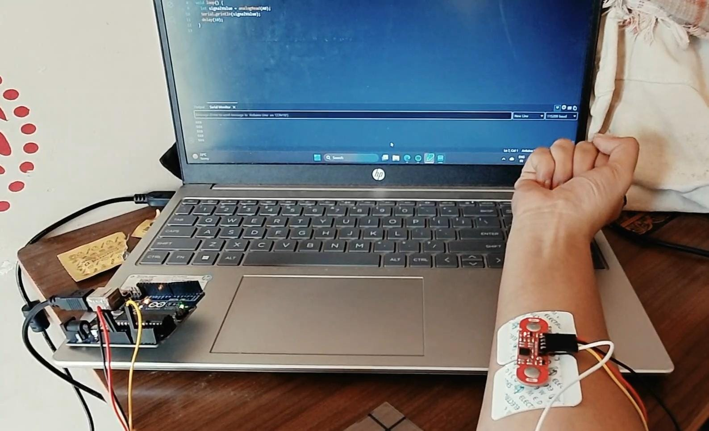
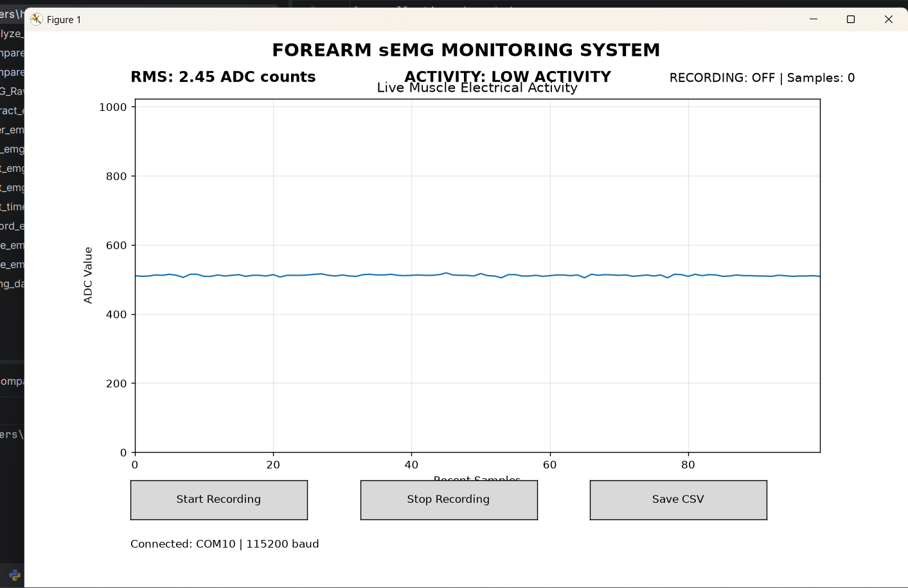
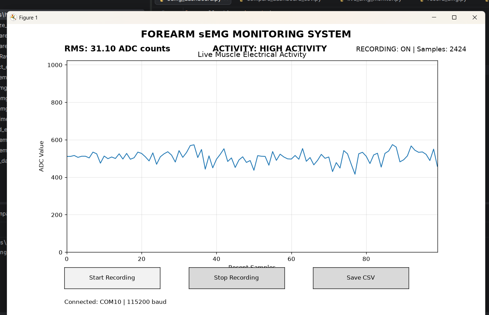
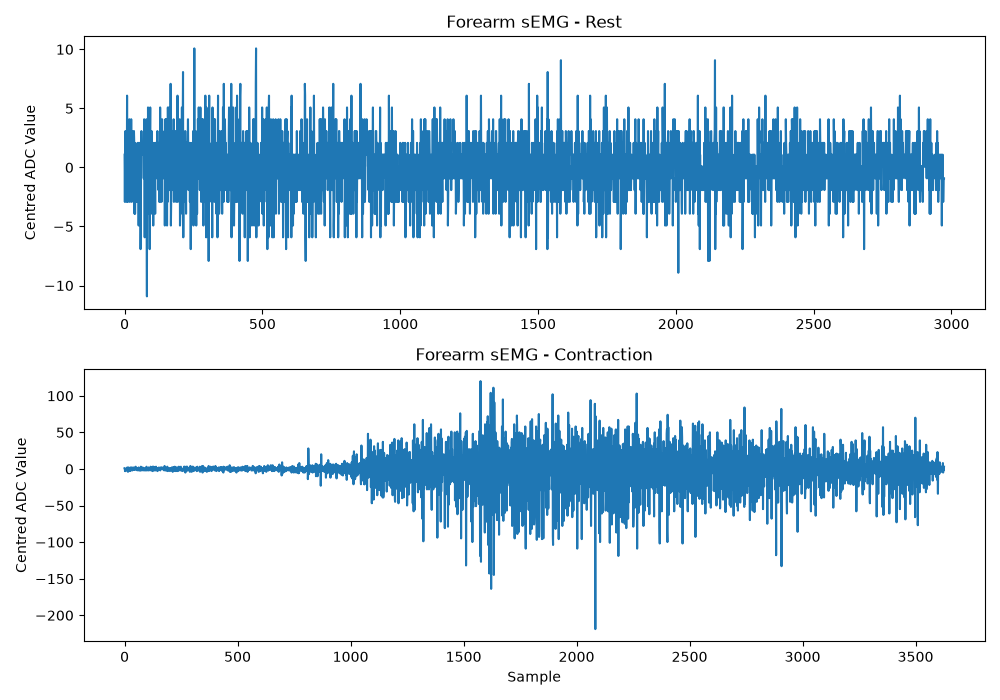

# Real-Time Forearm sEMG Live Monitoring System

### Surface Electromyography | Biomedical Instrumentation | Signal Processing | Python

<p align="center">
  A Biomedical Engineering Project
</p>

---

## 1. Project Overview

The **Real-Time Forearm sEMG Live Monitoring System** is a biomedical engineering project developed to acquire, visualize, and analyze electrical activity generated by forearm muscles.

The system uses a **Muscle BioAmp Patchy sensor** interfaced with an **Arduino UNO** to acquire surface electromyography (sEMG) signals. The acquired data is transmitted to a Python-based monitoring dashboard, where muscle activity is visualized and analyzed in real time.

The dashboard provides live waveform visualization, Root Mean Square (RMS) calculation, threshold-based muscle activity detection, and CSV data recording.

## 2. Project Objectives

- Acquire surface EMG signals from forearm muscles.
- Interface the Muscle BioAmp Patchy sensor with Arduino UNO.
- Develop a Python-based real-time monitoring dashboard.
- Analyze muscle activity using RMS and signal features.
- Compare resting and contraction signal patterns.
- Record and store acquired data for further analysis.

## 3. Hardware Components

| Component | Function |
|---|---|
| Arduino UNO | Microcontroller and analog data acquisition |
| Muscle BioAmp Patchy | sEMG signal sensing and conditioning |
| Surface Electrodes | Acquire electrical muscle activity |
| Breadboard | Circuit interfacing |
| Jumper Wires | Electrical connections |
| USB Cable | Power and serial communication |
| Computer | Signal processing and visualization |

## 4. Software and Technologies

- **Programming Language:** Python
- **Microcontroller Programming:** Arduino IDE
- **Development Environment:** PyCharm
- **Libraries:** NumPy, Matplotlib, Pandas, PySerial, SciPy

## 5. System Architecture

The system follows the signal acquisition and processing pipeline:

```text
Forearm Muscle Activity
          ↓
Surface EMG Electrodes
          ↓
Muscle BioAmp Patchy
          ↓
Arduino UNO
          ↓
Serial Communication (115200 Baud)
          ↓
Python Data Acquisition
          ↓
Signal Processing and RMS Calculation
          ↓
Threshold-Based Activity Detection
          ↓
Real-Time Monitoring Dashboard
          ↓
CSV Data Storage and Analysis
```

## 6. Working Principle

1. Surface electrodes acquire electrical activity associated with forearm muscle activation.
2. Muscle BioAmp Patchy conditions the acquired EMG signal.
3. Arduino UNO reads the analog signal through its ADC.
4. Digital readings are transmitted to the computer through serial communication.
5. Python receives incoming data using PySerial.
6. RMS values are calculated from acquired signal samples.
7. A predefined threshold indicates different muscle activity conditions.
8. Matplotlib displays the live waveform and monitoring parameters.
9. Acquired samples can be recorded and exported into CSV files for offline analysis.

## 7. Project Demonstration

### 7.1 Hardware Implementation

The experimental setup uses Arduino UNO and Muscle BioAmp Patchy for forearm surface EMG signal acquisition.



### 7.2 Real-Time EMG Monitoring Dashboard

The Python dashboard enables continuous visualization and monitoring of acquired muscle activity.

**Low Muscle Activity**



**High Muscle Activity**



The dashboard displays live EMG waveforms, RMS values, activity status, and recording controls.

### 7.3 Rest vs Muscle Contraction Analysis

The acquired signals are compared under resting and contraction conditions.



The comparison demonstrates variations in signal amplitude and waveform patterns during different muscle activity conditions.

## 8. Signal Processing and Analysis

The project explores the following time-domain features:

- **Mean Absolute Value (MAV):** Represents the average absolute amplitude of the signal.
- **Root Mean Square (RMS):** Represents the effective amplitude of the acquired EMG signal.
- **Variance:** Measures signal amplitude variation.
- **Standard Deviation:** Describes signal dispersion.
- **Waveform Length:** Represents cumulative changes in signal amplitude.

These features help characterize variations in forearm muscle activity.

## 9. Key Features

- Real-time sEMG waveform monitoring.
- RMS-based muscle activity analysis.
- Threshold-based activity indication.
- Live signal visualization using Python.
- Start and stop recording functionality.
- CSV data acquisition and storage.
- Resting and contraction signal comparison.
- Offline signal processing and feature extraction.

## 10. Applications

- Biomedical signal monitoring and analysis.
- Muscle activity assessment.
- Rehabilitation research.
- Human-computer interaction research.
- EMG-based assistive technology research.
- Biomedical instrumentation education.

## 11. Limitations

- Signal quality depends on electrode placement and skin-electrode contact.
- Electrical noise and movement artifacts may affect signal quality.
- Threshold values require appropriate adjustment.
- The prototype is intended for educational and experimental purposes and is not a clinically validated diagnostic device.

## 12. Future Scope

- Multi-channel EMG signal acquisition.
- Advanced digital filtering and artifact reduction.
- Improved muscle activity classification.
- Machine learning-based EMG analysis.
- Wireless and wearable monitoring.
- Integration with rehabilitation and assistive technologies.

## 13. Repository Structure

```text
Forearm-sEMG-Live-Monitoring-System/
│
├── images/
│   └── images/
│       ├── dashboard_high_activity.png
│       ├── dashboard_low_activity.png
│       ├── hardware_setup.jpg
│       └── rest_vs_contraction.png
│
├── README.md
├── requirements.txt
├── .gitignore
│
└── Python and signal-processing scripts
```

## 14. Installation and Execution

**Step 1: Clone the repository**

```bash
git clone https://github.com/nishka2310/Forearm-sEMG-Live-Monitoring-System.git
```

**Step 2: Navigate to the project directory**

```bash
cd Forearm-sEMG-Live-Monitoring-System
```

**Step 3: Install the required Python libraries**

```bash
pip install -r requirements.txt
```

**Step 4: Run the project**

Connect the Arduino UNO, configure the appropriate serial COM port in the Python script, and execute the dashboard script.

## 15. Project Information

| Parameter | Details |
|---|---|
| Domain | Biomedical Engineering |
| Project Type | Hardware and Software Integration |
| Microcontroller | Arduino UNO |
| Sensor | Muscle BioAmp Patchy |
| Programming Language | Python |
| Signal Type | Surface Electromyography (sEMG) |
| Communication | Serial Communication (115200 Baud) |

---

<p align="center">
  <i>Reimagining healthcare through engineering and curiosity.</i>
</p>
