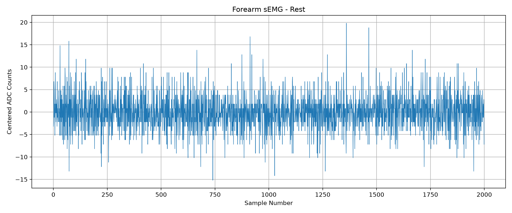
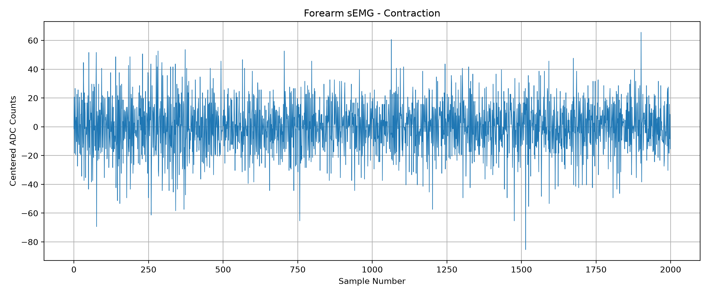
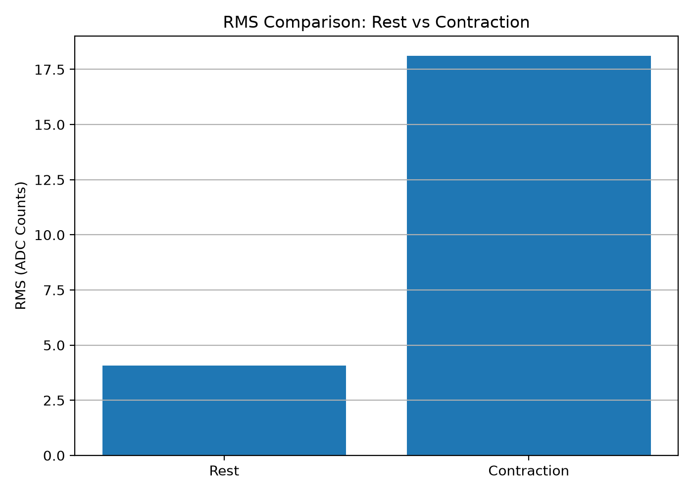

# Real-Time Forearm sEMG Live Monitoring System

### Surface Electromyography (sEMG) | Arduino UNO | Python | Biomedical Signal Processing

## 1. Project Overview

The Real-Time Forearm sEMG Monitoring System is a biomedical engineering project developed to acquire, visualize and analyze electrical activity generated by forearm muscles.

The system uses a Muscle BioAmp Patchy sensor interfaced with an Arduino UNO to acquire muscle activity signals. The acquired data is transmitted to Python, where a real-time monitoring dashboard displays the signal waveform, calculates RMS values and identifies muscle activity using a predefined threshold.

The system also supports data recording, CSV export and offline signal analysis.

## 2. Objectives

- Acquire surface EMG signals from forearm muscles.
- Interface the sEMG sensor with Arduino UNO.
- Develop a Python-based real-time monitoring dashboard.
- Analyze muscle activity using RMS and other signal features.
- Compare resting and contraction signal patterns.
- Record and store acquired data for further analysis.

## 3. Hardware Components

| Component | Purpose |
|---|---|
| Arduino UNO | Microcontroller and data acquisition |
| Muscle BioAmp Patchy | Surface EMG signal sensing |
| Surface electrodes | Muscle signal acquisition |
| Jumper wires | Electrical connections |
| Breadboard | Circuit interfacing |
| USB cable | Power and serial communication |
| Computer | Data visualization and analysis |

## 4. Software and Technologies

- Python
- Arduino IDE
- PyCharm
- NumPy
- Pandas
- Matplotlib
- PySerial
- SciPy
- Tkinter

## 5. System Architecture

Forearm Muscle Activity  
↓  
Surface EMG Electrodes  
↓  
Muscle BioAmp Patchy  
↓  
Arduino UNO  
↓  
Serial Communication (115200 Baud)  
↓  
Python Data Processing  
↓  
RMS Calculation and Activity Detection  
↓  
Real-Time Dashboard  
↓  
CSV Data Storage and Analysis

## 6. Working Principle

1. Surface electrodes acquire electrical activity associated with forearm muscle activation.
2. The Muscle BioAmp Patchy conditions the acquired signal.
3. Arduino UNO reads the analog signal and transmits digital ADC readings through serial communication.
4. Python receives the incoming data using PySerial.
5. NumPy processes the recent signal samples and calculates RMS.
6. A predefined threshold is used to indicate low or high muscle activity.
7. Matplotlib displays the real-time waveform and monitoring parameters.
8. Recorded samples can be exported into CSV format for further analysis.

## 7. Key Features

- Real-time EMG waveform visualization.
- RMS-based signal analysis.
- Threshold-based muscle activity indication.
- Start and stop recording controls.
- CSV data export.
- Resting and contraction signal comparison.
- Offline signal processing and feature extraction.

## 8. Signal Analysis

The project includes analysis of resting and contraction conditions.

The following signal features are explored:

- Mean Absolute Value (MAV)
- Root Mean Square (RMS)
- Variance
- Standard Deviation
- Waveform Length

These features help describe changes in the acquired muscle activity signal.

## 9. Results and Visualizations

### Resting Muscle Activity

### Muscle Contraction

### Rest vs Contraction Comparison

## 10. Applications

- Biomedical signal monitoring.
- Muscle activity analysis.
- Rehabilitation research.
- Human-computer interaction research.
- Preliminary exploration of EMG-based assistive systems.
- Educational applications in biomedical instrumentation.

## 11. Limitations

- Signal quality depends on electrode placement and skin-electrode contact.
- Movement artifacts and electrical noise may affect the acquired signal.
- The activity threshold requires appropriate adjustment for the experimental setup.
- The current prototype is not a clinically validated diagnostic device.

## 12. Future Scope

- Multi-channel EMG acquisition.
- Advanced signal filtering and artifact reduction.
- Improved activity classification.
- Integration with machine learning algorithms.
- Wearable and wireless monitoring.
- Extension towards rehabilitation and assistive technology research.

## 13. Project Information

**Project Domain:** Biomedical Engineering  
**Hardware:** Arduino UNO and Muscle BioAmp Patchy  
**Programming Language:** Python  
**Development Environment:** PyCharm and Arduino IDE

---

*Reimagining healthcare through engineering and curiosity.*
